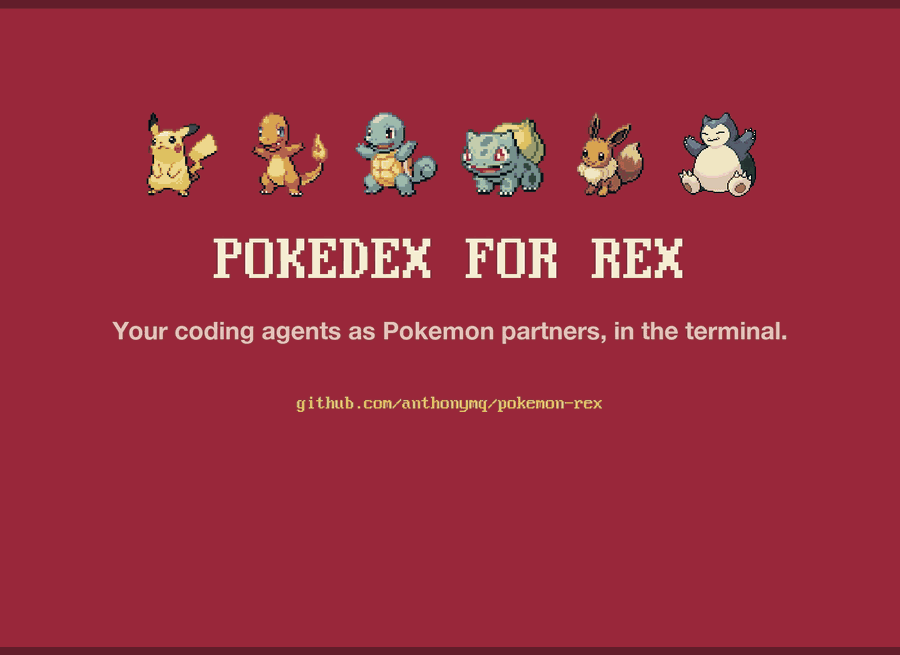
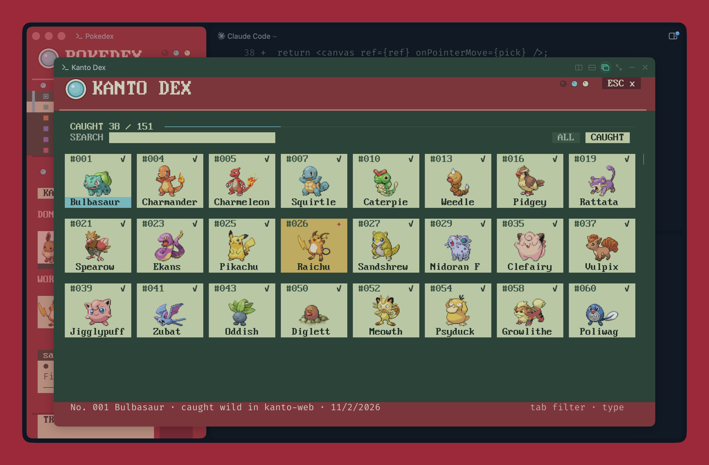
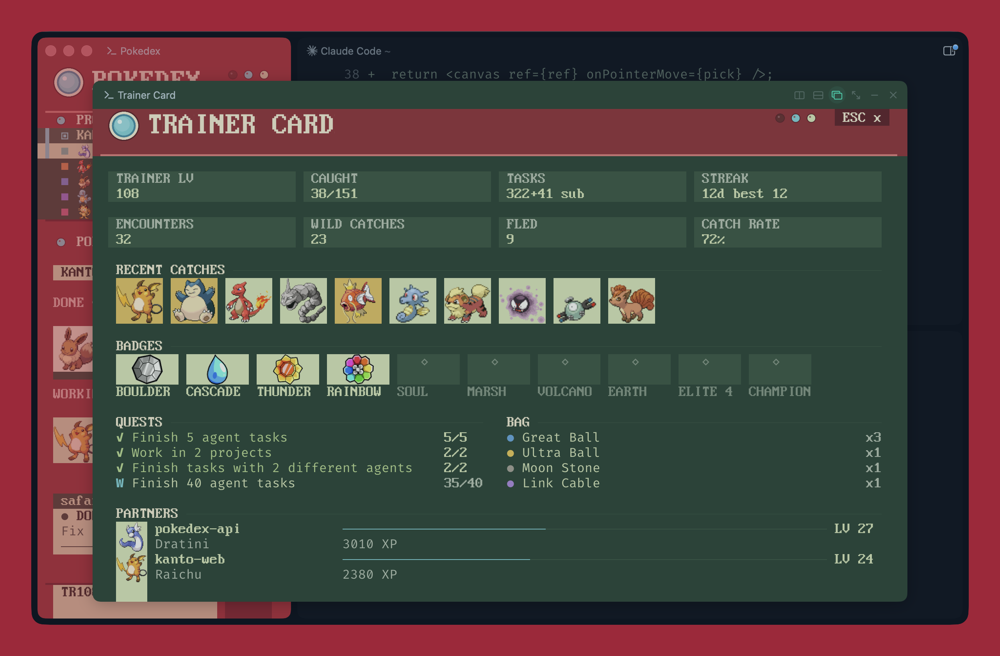

# Gotta Ship 'Em All

**A Pokedex for [Rex](https://www.superlogical.com/rex/docs). Your coding agents' work trains your Pokemon party, every project gets a mascot, and finishing work is how you fill the Pokedex.**



Claude Code is porting a town map. Codex is fixing a step counter. Beside them, in a red Kanto Pokedex, Pikachu and Eevee bob along while they work.

Then a task finishes. XP lands. Charmander hits Lv 16 and evolves on its own. And sometimes a wild Snorlax shows up in the tall grass, waiting for you to finish what you're doing.

---

## What happens while you work

| When | What you see |
| --- | --- |
| An agent starts in a project | The project gets a mascot Pokemon. |
| An agent is working | The mascot bobs in the sidebar. |
| An agent finishes a task | **10 XP, +5 per minute it ran, up to 50**, to your party's lead. Level-ups, then evolutions at the real Gen 1 levels. |
| The turn made a commit | **+20 XP.** |
| An agent is waiting on you | It jumps to the top under **NEEDS YOU**, in amber, blinking `!`. Answer within 2 minutes: +25% XP on that project's next task. |
| A task finishes (15% of the time) | A wild Pokemon joins the tall grass. Three free Poke Balls, and it waits a day. |
| You pass a quest tier | **Bronze, Silver or Gold**, each sized to your own pace. Every tier pays. |
| You keep a streak going | Shinies start showing up at 7 days, more at 30. Two days off a week never break it. |
| You come back from a few days off | **Rested XP**: your next XP counts double until the bank runs out. |

Agents are found by [OSC 7501](https://www.superlogical.com/rex/docs/build/program-status), the status protocol Claude Code, Codex and others already speak. Nothing is guessed from screen text.

---

## The game

### Your party and XP

You start by choosing **Bulbasaur, Charmander or Squirtle** on the trainer card (the sidebar says `Choose your starter`). XP earned before that waits for it.

Your **party** holds up to 6 Pokemon from your Pokedex. The first one **leads**: every XP award goes to it, whatever project the agent worked in. The others train at the **Day Care** and get 25% of it. Change the lead and the party on the trainer card (`p`).

- **10 XP** per finished task, **+5 per full minute** it ran, up to **50**
- **10 XP** for each finished sub-agent
- **Results** pay the rest: **+20** when the turn made a commit. The server also pays +30 for green tests and +50 plus an Ultra Ball for a merge, but Rex doesn't report those yet. Each pays once per turn.
- **Daily diminishing returns**, the same in 1 repo or 10: the day's turns 1-5 pay in full, 6-20 pay 40%, 21-50 pay 10%, then 3%.
- **Rested XP** for time away: each day off beyond the two a week a streak allows banks one day of your own average XP, up to three days of it, and XP counts double until the bank is spent. A normal weekend banks nothing, so taking the weekend off costs you nothing and a holiday gives you a running start.
- Level *n* costs `4 × n²` XP: Lv 16 is 1,024 XP, Lv 100 is 40,000

Every project (a git repo, else a folder) has a **mascot**, drawn on its agents' cards and tabs. It's cosmetic: pick any Pokemon you caught with `p` in the sidebar.

Pokemon **evolve at their real Gen 1 levels**. Charmander becomes Charmeleon at 16. Dratini makes you wait until 30, then 55. Magikarp is still Magikarp until 20.

Stone and trade evolutions need the item: Fire, Water, Thunder, Leaf and Moon Stones, and a **Link Cable** for the four that used to need a friend. Long tasks and quests drop them, and you choose when to use one on a party member (trainer card, `p`, then `1`-`3`).

### Wild encounters


- **3 free Poke Balls** per encounter, then any Poke Balls in your bag. Great Balls (×1.5) and Ultra Balls (×2) come from the bag too.
- Base odds: **60%** for most, **35%** for final evolutions, **3%** for legendaries.
- **Keep working and it weakens.** Each task finished while it waits adds 25% to your odds, up to three times.
- **The tall grass** holds up to 5 wild Pokemon. Each waits 24 hours, then leaves. Nothing opens on its own: the sidebar shows `Tall grass 2/5`; open it with `e`, a click or `ctrl+a e` and pick which one to throw at.
- A toast for a new one depends on `pokedex set alert`: `smart` (the default) only while no agent is working, `on` always, `off` never.

### Hard mode

Off by default. With `pokedex set hard-mode on`, an agent left waiting on you for 10 minutes makes its project's mascot faint, and that project's next task earns no XP.

### Kanto Dex



All 151, searchable by name or number. Your catches are lit; the ones you're missing stay as dim sprites, still searchable. Every catch remembers how you got it (your starter, a gift, caught wild, evolved, a former project partner), where and when. Shinies get a gold mark.

### Trainer card



- **Your trainer level** comes from all the XP you ever earned: level *n* starts at `40 × n²`. **Gifts** arrive at trainer levels 5 (Eevee), 10 (Lapras), 15 (Omanyte or Kabuto), 20 (Hitmonlee or Hitmonchan) and 30 (Porygon); when there's a choice, the card asks (`g`).
- **Your party**, the lead first. `p` opens the party editor: `enter` makes a Pokemon the lead, `space` adds or removes it, `1`-`3` use a stone or the Link Cable.
- **Eight Kanto badges** and two ranks past them: Elite Four at 1,000 tasks, Champion with all eight badges. Rainbow needs a 2-week streak and Volcano an 8-week one.
- **Three daily quests and one weekly, sized to you.** Each has **Bronze, Silver and Gold** at 50%, 100% and 150% of your own median over the past two weeks, never below a floor, so a quiet week asks less of you and a heavy one asks more. Every tier pays: a daily quest gives a Great Ball, then two, then an Ultra Ball and 50 PokéDollars. A quest is only offered when your last 30 days show you can do it, and `1`-`3` (or a click) **rerolls** one that hasn't paid yet, once a day.
- **Your streak**, which counts days rather than amount: a day keeps it when 5 of the 7 days ending with it were active, so any two days off a week are fine. A **Streak Freeze** arrives every 7 active days (2 at most) and spends itself on a missing day that would otherwise break it. The card shows how many you hold.
- **Your bag**, your PokéDollars, any Rested XP waiting, and your recent catches.

A new save opens on **Professor Oak's** five first steps (open an agent, finish a task, catch a wild Pokemon, change your lead, open this card); finishing them pays 5 Poke Balls. A save from before the party opens the card on a short **New Pokedex** tour, once.

---

## Install

You need [Bun](https://bun.sh), Rex and the [Pokedex agents server](https://github.com/anthonymq/pokedex-agents-server), which holds the game and your progress. Clone both:

```sh
git clone https://github.com/anthonymq/pokedex-agents-server.git ~/.local/share/pokedex-agents-server
git clone https://github.com/anthonymq/pokemon-rex.git ~/.config/rex/pokedex
```

The Pokedex starts the server when it isn't running. Put the server somewhere else with `$POKEDEX_SERVER_DIR` or `server.dir` in the config.

Add one line to `~/.config/rex/init.lua`:

```lua
require("pokedex")
```

Then `rex config reload`, and press `ctrl+a o`.

Also playing in [pokemon-herdr](https://github.com/anthonymq/pokemon-herdr)? It uses the same server, so both apps share one save, and a project whose repo path is the same in both keeps its mascot. To replace your progress with a copy of an old Herdr `shared.json` instead, run `bun ~/.config/rex/pokedex/bin/pokedex.js import-herdr [file] --force`. The server keeps a backup.

---

## Keys

| Key | Action | What it opens |
| --- | --- | --- |
| `ctrl+a o` | `pokedex_toggle` | The sidebar, a full-height pane at the edge of the current tab. Again to close. |
| `ctrl+a g` | `pokedex_jump` | Teleport to the agent you picked in the sidebar, else the one that most needs you (blocked, then done, then working). |
| `ctrl+a d` | `pokedex_collection` | The Kanto Dex. |
| `ctrl+a t` | `pokedex_trainer` | The trainer card. |
| `ctrl+a e` | `pokedex_encounter` | The tall grass: the waiting wild Pokemon, focused so you can throw. |

All five are in the command palette under "Pokedex". Change the keys in `pokedex/init.lua` if they clash with yours.

In the sidebar:

| Key | |
| --- | --- |
| `h` `j` `k` `l` or arrows | select an agent |
| `enter` or click | go to that agent's tab and focus its pane |
| `p` or right-click | choose the project's mascot from your catches |
| `s` | group agents by priority or by session |
| `d` `t` `e` | Kanto Dex, trainer card (party, starter, gifts), tall grass |
| `?` `q` | help, close |

On the battle card: `←` `→` choose a Pokemon, `1` Poke Ball, `2` Great Ball, `3` Ultra Ball, `r` run, `q` close (they keep waiting). Or click.

On the trainer card: `p` party, `c` starter, `g` a waiting gift, `1`-`3` reroll one of today's quests, `s` share on X, `q` close. Or click.

---

## The sidebar, top to bottom


- **The brand plate**: the lens and three status lights (yellow when an agent needs you, cyan when one is working).
- **PROJECTS / SESSIONS**: each session is a heading band, its tabs are rows under it with the mascot of the agent in that tab and a mark (`!` needs you, `*` done, a spinner while working). Click a row to go to that tab.
- **POKEMON / AGENTS**: the Kanto Dex button, then one tile per agent under NEEDS YOU, DONE, WORKING and IDLE.
- **The agent card**: project, status, mascot, program, its task, and your lead's level and XP strip.
- **The news row**: the latest news, else what waits on the trainer card (`Choose your starter`, a gift), else the tall grass.
- **The trainer strip**: trainer level, streak, badges. Click it for the trainer card.

**News** (evolutions, badges, a "Welcome back!" summary) shows as a small floating pane at the top right of the session it happened in, for 7 seconds, without taking focus. Small news (level-ups, found items, quests) only shows in the sidebar's news row; the server sums it up in the "Welcome back!" note after 2 hours away.

**Tab names.** Rex's own sidebar can't hold custom content, but it shows tab names. With `labels.enabled`, a tab holding an agent is named after its mascot, such as `Meowth · rex`. Only tabs still carrying Rex's default name are renamed; a tab you named yourself is left alone.

---

## Settings

Optional, in `~/.local/state/rex-pokedex/config.json`:

```json
{
  "sidebar": { "auto": true, "side": "left", "columns": 30 },
  "labels": { "enabled": true },
  "toasts": { "enabled": false }
}
```

| Setting | |
| --- | --- |
| `sidebar.side` | `right` (default) or `left`. |
| `sidebar.columns` | Width in terminal cells, the same in every tab. 30 is slim and still fits everything. |
| `sidebar.width` | Width as a share of the tab (default 0.25), used when `columns` is absent. |
| `sidebar.auto` | Keep the sidebar open in every session's current tab, so it is there wherever you switch. |
| `labels.enabled` | Name agent tabs after their mascot. |
| `toasts.enabled` | The floating news pane (on by default). |

Game options are the server's, shared with pokemon-herdr, and shown by `pokedex status` and on the trainer card: `pokedex set alert off|on|smart` and `pokedex set hard-mode on|off`.

The evolution and badge jingles are the server's: turn them off with `"sounds": { "enabled": false }` in `~/.local/state/pokedex-agents-server/config.json`. Off macOS the server hands them to Rex, which plays them with the first of `mpv`, `ffplay`, `mpg123` or `play` (sox) it finds.

Rex only knows a pane's real size while it is on screen, so with `columns` the sidebar measures itself when shown and moves its own border; a sidebar opened in a background tab settles to the exact width when you first look at it.

---

## Commands

```sh
pokedex toggle                 # sidebar in this window
pokedex open collection        # add --pick <project> for the mascot picker
pokedex open trainer           # also the party, the starter choice and gifts
pokedex open encounter
pokedex status                 # daemon, trainer, options and agents as text
                               # also any reports queued for the server, and a rules mismatch
pokedex set alert smart        # off | on | smart: toasts for new wild Pokemon
pokedex set hard-mode off      # on: mascots can faint
pokedex catch 25               # debug only (server started with POKEDEX_DEBUG=1); release 25 undoes it
pokedex stop | log             # the daemon
```

(`pokedex` here is `bun ~/.config/rex/pokedex/bin/pokedex.js`.)

---

## How it works

Rex has no native mods or layouts, so this is a terminal app: a sidebar pane and floating dialogs, drawn with true color and the real sprites through kitty graphics, which Rex's terminal supports. The pixel-font headings are pictures too.

- **The game** is the [Pokedex agents server](https://github.com/anthonymq/pokedex-agents-server)'s. It plays the rules and keeps your progress. Every pokedex process follows it live and sends it what happens, so Rex and Herdr play one save.
- **A daemon** (`pokedex daemon`) follows `rex events --all` for every session. When an agent goes from working to idle or done, it reports the finished task to the server (and a commit, when the repo's HEAD moved to a new one during the turn, and the branch it ran on), and it shows the news Rex caused as toasts. It starts with the Rex server, and any pokedex command restarts it if it is gone. XP only counts while it runs.
- **Nothing is lost while the server is down.** Each report carries the moment it happened. One the server can't take waits in `outbox.json` and goes out, oldest first, once it answers again; the server counts it on its own day. `pokedex status` says how many are waiting. A report more than 3 days late is dropped.
- **The clock belongs to the server.** It sends today's quests and your live streak with the state, and the views draw them as sent, so this copy of the rules can never show different ones. It also sends its rules version: when it differs from this copy's, the sidebar and `pokedex status` say to run `scripts/sync-game.sh`.
- **Your project names stay on your machine.** The server keys projects in the save by a hash, and keeps the readable paths beside it in `local.json`. Rex is sent those names, so cards and the Dex still read `pokedex-agents-server`, while the save itself holds no path.
- **Rex's own state** lives in `~/.local/state/rex-pokedex/` (`$XDG_STATE_HOME`, or `$POKEDEX_STATE`): the settings, the daemon's pid and log, and `agents.json`, the daemon's live list of agents.

### Differences from pokemon-herdr

- No window chrome: Rex's own tabs, pane frames and status stay as they are.
- `enter` in the sidebar shows the agent's tab only when Remote Control is on in Rex's settings. With it off, the sidebar remembers the pick and `ctrl+a g` takes you there.
- Pins, drag reordering and the alerts drawer are not ported.
- The blocked pulse is a blinking `!` (terminal pictures can't fade).

---

## Develop

The rules and their tests live in pokedex-agents-server. `src/game.js` and `src/pokemon.js` are copies of its files, kept for read-only helpers (levels, names, odds). `scripts/sync-game.sh` refreshes them, and `--check` reports a copy that differs. `src/herdr.js` stands in for Herdr's `herdr` module (`tsconfig.json` maps the import), and it refuses any change to the game: changes go through `src/client.js`.

To look at a view without a terminal, dump one frame and turn it into a PNG (needs Pillow):

```sh
POKEDEX_DUMP=/tmp/frame.json POKEDEX_SIZE=100x34 bun bin/pokedex.js collection
python3 tools/preview.py /tmp/frame.json /tmp/frame.png
```

`python3 tools/make_art.py` redraws `assets/ui/`: the lens, the lights and the pixel-font glyph strips.

| File | |
| --- | --- |
| `src/game.js`, `src/pokemon.js` | the rules and names, from pokemon-herdr |
| `src/herdr.js` | shared state file, lock, settings, notify and sound hooks |
| `src/daemon.js` | follows Rex events, tracks agents, awards XP |
| `src/core.js` | mascots, news, toasts, opening dialogs |
| `src/rex.js` | `rex` CLI wrappers: views, splits, floating panes |
| `src/term.js`, `src/png.js` | the TUI kit: cells, kitty pictures, input; sprite cropping |
| `src/views/` | sidebar, collection, trainer (with `party.js`: party, starter, gifts, the New Pokedex tour), encounter, toast; `chrome.js` is their shared header |
| `tools/` | `make_art.py` draws the UI art, `preview.py` renders a dumped frame |
| `init.lua` | Rex actions and keys |

---

Sprites and Pokemon names are third-party artwork; see [NOTICE.md](NOTICE.md). The screenshots show a staged session with scripted agents.
